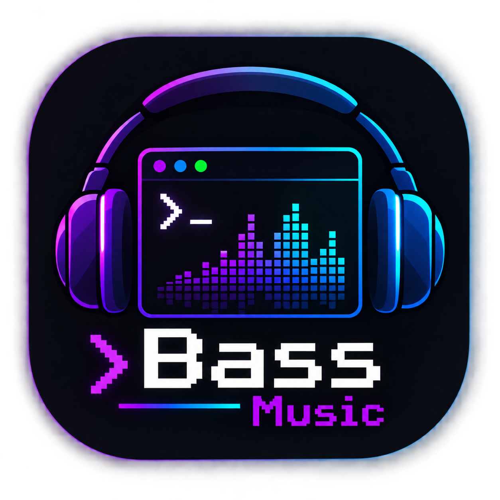

<div align="center">
  
  <h1>Bass Music</h1>
  <p><strong>A Professional Terminal Music Player (TUI)</strong></p>
  
  <p>
    <a href="https://github.com/nbmsystemas/Bass-Music/commits/main"></a>
    <a href="https://github.com/nbmsystemas/Bass-Music/issues"></a>
    <a href="https://github.com/nbmsystemas/Bass-Music/network/members"></a>
    <a href="https://github.com/nbmsystemas/Bass-Music/stargazers"></a>
    <a href="https://opensource.org/licenses/MIT"></a>
  </p>
</div>

---

## 🎵 Overview

**Bass Music** is a 100% terminal-based (no GUI required) professional music player built with Python and `curses`. Powered by the robust `mpv` engine and `yt-dlp`, it offers a rich, interactive experience directly from your command line. 

Whether you want to play local high-fidelity FLAC files, stream a live online radio, or directly load music from YouTube and SoundCloud, Bass Music handles it seamlessly.

### ✨ Key Features

- **TUI & Mouse Support:** Fully interactive curses-based interface with both keyboard and mouse controls.
- **Library Browser & Smart Mixes:** Navigate your local files or auto-filter your playlist by genres like Rock, Pop, or Zen directly from the sidebar.
- **Universal Playback:** Plays local files (`.mp3`, `.flac`, `.wav`, etc.) and URLs (YouTube, SoundCloud, direct streams).
- **10-Band Equalizer:** Live EQ with 6 built-in presets.
- **Professional Spectrum Analyzer:** Visualizes the actual audio playing on your system in real-time with exponential smoothing (gravity) and Automatic Gain Control (AGC).

---

## 🚀 Installation & Compatibility

**Platform Support:**
- 🐧 **Linux:** Fully supported (Arch, Ubuntu, Fedora, etc.).
- 🍎 **macOS:** Fully supported via Homebrew.
- 🪟 **Windows:** Supported natively via WSL (Windows Subsystem for Linux).

### One-Step Install

Open your terminal and paste the following command. It will automatically detect your OS, install dependencies (`mpv`), and configure Bass globally:

```bash
curl -sL https://raw.githubusercontent.com/nbmsystemas/Bass-Music/main/install.sh | bash
```

### Maintenance Commands

- **Update to the latest version:** `bass --update`
- **Uninstall completely:** `bass --uninstall`

---

## 🎮 Usage

Launch Bass Music from anywhere by simply typing:

```bash
# 1. Start the player (loads your saved playlist and local library)
bass

# 2. Play a specific YouTube video or stream URL directly
bass "https://www.youtube.com/watch?v=p0OH206z9Wg"

# 3. Play a local folder or file directly
bass ~/Music/MyAlbum
```

### Controls

| Key | Action |
|-----|--------|
| `Space` | Play / Pause |
| `n` / `p` | Next / Previous Track |
| `h` / `l` | Seek Backward / Forward 5 seconds |
| `k` / `j` | Volume Up / Down |
| `m` | Mute Toggle |
| `s` | Shuffle Toggle |
| `r` | Repeat Mode (Off → One → All) |
| `a` | Add Local File or Folder |
| `u` | Add URL (YouTube, SoundCloud, Radio, etc.) |
| `x` | Remove Selected Track from Playlist |
| `/` | Search / Filter Playlist |
| `Tab` | Switch Focus (Library ↔ Playlist ↔ Equalizer) |
| `e` | Show / Hide Equalizer Panel |
| `↑` `↓` | Navigate List or Adjust EQ Band |
| `←` `→` | Change EQ Band (when EQ is focused) |
| `1`-`6` | Apply EQ Preset (Flat, Bass, Rock, Pop, Vocal, Electro) |
| `M` | Mood Engine (Cyberpunk, Lo-Fi, Zen, Rock, Synthwave, Trap) |
| `S` | Toggle AI Mood Stream (Continuous background music) |
| `K` | Configure OpenRouter API Key directly |
| `g` | Generate Music (AI single track) |
| `G` | Cycle Generation Model |
| `?` | Show Help Overlay |
| `q` | Quit Application |

**Mouse Controls:**
- **Left Click** on a track or folder to play/open it.
- **Left Click** on the progress bar to seek.
- **Scroll Wheel** automatically scrolls whichever panel your cursor is hovering over.

---

## 🌌 Reactive Mood Engine & AI Stream Continuo (Release v1.2.0)

Inspirado en la orquestación generativa de `gentle-stream`, Bass incluye un **Reactive Mood Engine** que transforma la atmósfera de tu terminal y genera música infinita para streams:

- **Atajo `M` o click en `🌌 Mood`:** Seleccioná entre presets calibrados (*Cyberpunk Night*, *Lo-Fi Café*, *Zen Chill*, *Rock Energy*, *Synthwave 80s*, *Dark Trap*) o escribí tu propio estado de ánimo en texto libre.
- **Transformación reactiva en vivo:**
  - 🎨 **Paleta de colores:** Cambia los contrastes y acentos visuales de curses según la atmósfera.
  - 🎚️ **10-Band EQ:** Aplica al instante la curva de ecualización ideal para ese género.
  - 📊 **Spectrum Analyzer:** Cambia el estilo de renderizado de barras del analizador FFT en tiempo real.
- **Atajo `S` o click en `📻 AI Mood Stream`:** Activa el modo de transmisión continua. Bass va generando y encolando nuevos bloques musicales coherentes en segundo plano antes de que termine el tema actual, logrando un stream ininterrumpido sin silencios.

---

## 🎹 AI Music Generation

Bass can generate original background music from a text prompt (genre/mood) — handy for stream backgrounds and royalty-free-friendly content.

- Press `g` (or click `✨ Generar música` in the library) and type a genre/mood, e.g. `lo-fi jazz`, `trap`, `synthwave`.
- Press `G` to cycle the generation model.
- The generated track is added to the playlist, plays immediately, and loops (repeat = one).
- Generated tracks are saved locally under `~/Música/MusicAI/` (shortcut `🎼 Mis temas generados` in the library) and are never deleted.

### Backends

Bass picks the backend automatically:

1. **Cloud — Google Lyria 3 via OpenRouter** (used when configured). Set your API key:
   ```bash
   export OPENROUTER_API_KEY=sk-or-...
   ```
   Models: `google/lyria-3-clip-preview` (~30s, $0.04) and `google/lyria-3-pro-preview` (~3min, $0.08). Requires OpenRouter credits (a few dollars) — each track costs $0.04–$0.08. The cloud backend needs no extra Python dependencies.

2. **Local — Meta MusicGen** (free, no API key). Optional dependencies:
   ```bash
   pip install torch transformers scipy accelerate
   ```
   The first run downloads the model (~2GB) and is slow without a GPU.

### ⚠️ Legal note

- Cloud output (Lyria 3) is licensed for commercial use under Google's terms, but OpenRouter is an intermediary — review both providers' terms before monetizing.
- Local MusicGen weights are **CC-BY-NC 4.0 (non-commercial)**; do not use them in monetized streams.
- No AI model guarantees freedom from copyright claims. Avoid prompts that recreate a specific existing song or clone a real artist's voice; original genre/mood prompts are the safe path.

---

## 🤝 Contributing

Contributions, issues, and feature requests are highly welcome! We want to make Bass the best terminal music player out there.

1. Fork the Project
2. Create your Feature Branch (`git checkout -b feature/AmazingFeature`)
3. Commit your Changes (`git commit -m 'Add some AmazingFeature'`)
4. Push to the Branch (`git push origin feature/AmazingFeature`)
5. Open a Pull Request

---

<div align="center">
  <p>Made with ❤️ for the terminal enthusiasts.</p>
</div>
